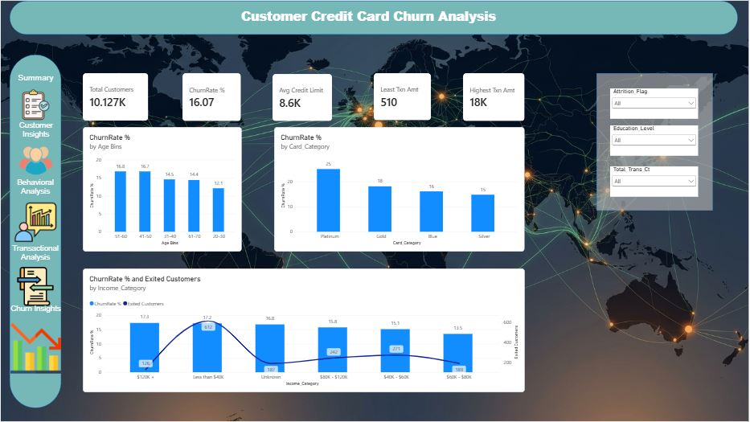

# Customer Credit Card Churn Analysis | Power BI Dashboard

An interactive, five-page Power BI dashboard that analyzes credit card customer attrition for a portfolio of **10,127 customers**. It identifies who is leaving, how they behave before leaving, and which segments need retention attention first.

---

## Dashboard Preview

| Summary | Customer Insights |
|---|---|
|  |  |

| Behavioral Analysis | Transactional Analysis |
|---|---|
|  |  |

| Churn Insights |
|---|
|  |

---

## Business Problem

Acquiring a new credit card customer costs far more than retaining an existing one. The goal of this project is to answer:

- What is the overall churn rate, and which segments are above it?
- Which demographic and card attributes are linked to attrition?
- Which behaviors (inactivity, contacts, relationship depth) signal a customer is about to leave?
- How do spending patterns and credit utilization relate to churn?
- Which customers should be prioritized for retention?

---

## Dashboard Pages

### 1. Summary
High-level KPIs and the main churn drivers at a glance.
- **KPIs:** Total Customers (10.127K), Churn Rate (16.07%), Avg Credit Limit (8.6K), Least Transaction Amount (510), Highest Transaction Amount (18K)
- **Charts:** Churn rate by age bin, by card category, and by income category (with exited customer count overlay)
- **Slicers:** Attrition Flag, Education Level, Total Transaction Count

### 2. Customer Insights
Demographic profile of the customer base.
- Churn rate by gender, education level, income category, and marital status
- Customer distribution by card category and income category (funnel)

### 3. Behavioral Analysis
How engagement with the bank relates to attrition.
- **KPIs:** Avg Months on Book (35.93), Avg Relationship Count (3.81), Avg Months Inactive (2.34)
- Churn rate by total relationship count and by months inactive
- Attrited vs. existing customers by contacts count in the last 12 months

### 4. Transactional Analysis
Spending activity, credit limits, and utilization.
- **KPIs:** Avg Credit Limit (8.63K), Avg Utilization Ratio (0.27), Total Transaction Amount (45M), Transaction Count (10.127K)
- Churn rate by transaction band, transaction count change band, credit limit bin, and utilization band
- Transaction volume distribution by credit limit bin

### 5. Churn Insights
Risk segmentation to support retention targeting.
- Customers split into **Low, Medium, and High Risk** segments
- Risk segment by income category and by attrition status
- Churn rate and relationship count by card category

---

## Key Findings

**Demographics**
- Overall churn rate is **16.07%**.
- Females churn more than males (**17.4% vs. 14.6%**).
- Churn is highest in the **41-60** age groups (~16.7-16.8%) and lowest among **20-30** year-olds (12.1%).
- Income shows a U-shape: both **$120K+ (17.3%)** and **Less than $40K (17.2%)** churn more than middle-income groups. Less than $40K also has the most exited customers (~612).
- **Doctorate** holders have the highest churn among education levels (~21%).

**Card Category**
- **Platinum** has the highest churn (25%), followed by Gold (18%), Blue (16%), and Silver (15%).
- **Blue** cards make up about **93%** of the customer base, so Platinum's rate is based on a very small group.

**Behavior**
- Churn falls as customers hold more products: **26-28%** at 1-2 products versus **~11%** at 6 products.
- Customers with **0 inactive months** show a 52% churn rate, and churn climbs again around **4 inactive months (30%)**.
- Attrition rises with more bank contacts in the last 12 months, and customers with 6 contacts are all attrited.

**Transactions**
- Customers whose transaction count dropped by **more than 50%** show a **51%** churn rate, the strongest single signal in the dashboard.
- Low-activity transaction bands (0-30 and 30-60) show **36-37%** churn, versus about 5% or lower for higher bands.
- Lower utilization bands churn more (**22%** at 0-20%, falling to ~6% at the highest band).
- Customers with credit limits under 5K churn the most (17%).

**Risk Segments**
- **72.2%** of customers are Low Risk, **26.5%** Medium Risk, and **1.3%** High Risk.
- Medium Risk contains a disproportionately large share of attrited customers relative to its size.

---

## Tools & Techniques

| Area | Details |
|---|---|
| Visualization | Power BI Desktop |
| Data modeling | Power Query (cleaning, binning, segmentation) |
| Calculations | DAX measures (Churn Rate %, averages, banded metrics) |
| Features | Slicers, custom navigation sidebar, multi-page layout, risk segmentation |

---

## Conclusion

The analysis shows that churn at this bank is driven more by **behavior than by demographics**. Age, gender, and income move the churn rate by only a few points around the 16% average, while behavioral and transactional signals move it dramatically.

The strongest early-warning indicators are:

1. **A sharp drop in transaction count** (over 50% decline), with a 51% churn rate.
2. **Low transaction activity and low credit utilization**, which suggest the card is no longer the customer's primary payment method.
3. **Shallow relationships**, since customers with 1-2 products churn at more than twice the rate of those with 5-6.
4. **Frequent contacts with the bank without resolution**, which is a sign of unresolved dissatisfaction.

**Recommendations**
- Trigger retention outreach automatically when a customer's transaction count falls sharply quarter over quarter.
- Run cross-sell and bundling campaigns to move single-product customers toward deeper relationships.
- Focus on the **Medium Risk** segment, where intervention can still change the outcome and the volume is meaningful.
- Review the Platinum and Gold card value proposition, and investigate why high-income and lowest-income customers both churn above average.
- Improve service resolution for customers with repeated contacts.

**Limitations:** Platinum and Gold figures rest on small customer counts, and the dashboard shows correlation, not causation. A predictive model (for example, logistic regression or gradient boosting) would be a logical next step to score churn probability for each customer.

---

## Author

**Harsha Vardhan Kolagani**
Data Analyst | SQL · Power BI · DAX · Python

- LinkedIn: [your-linkedin-url]
- GitHub: [your-github-url]
- Email: [your-email]

---

If you found this project useful, consider giving it a star.
